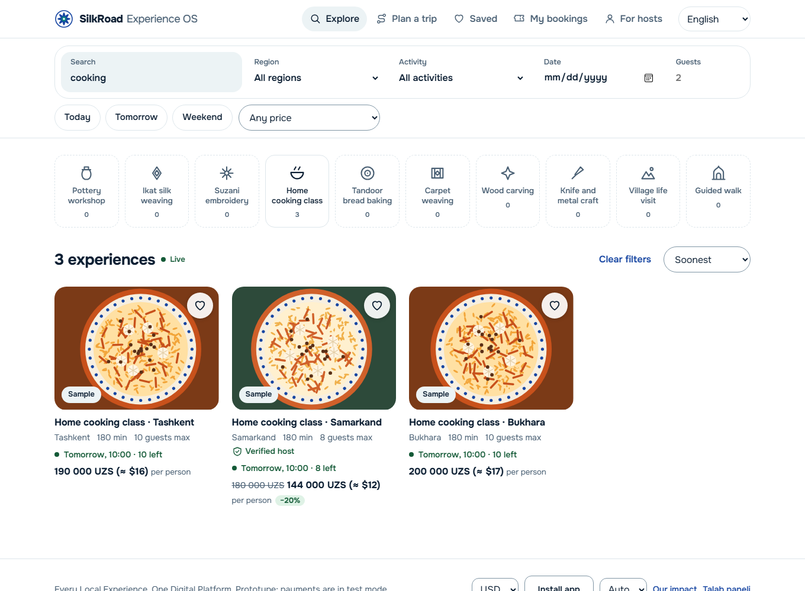
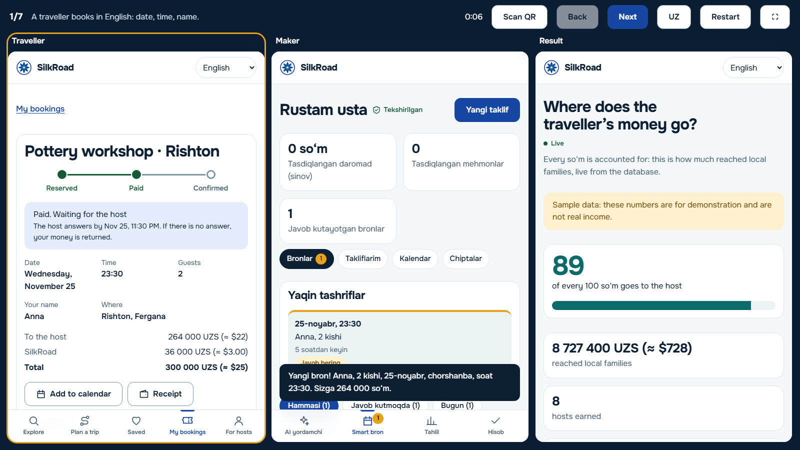
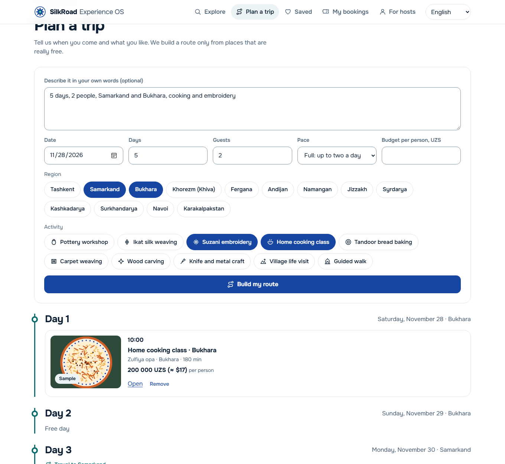
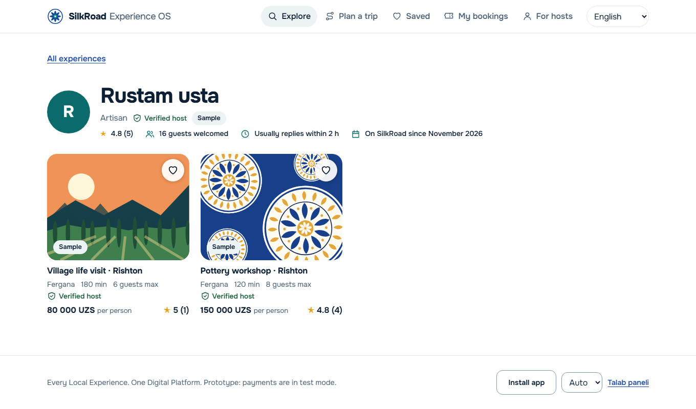
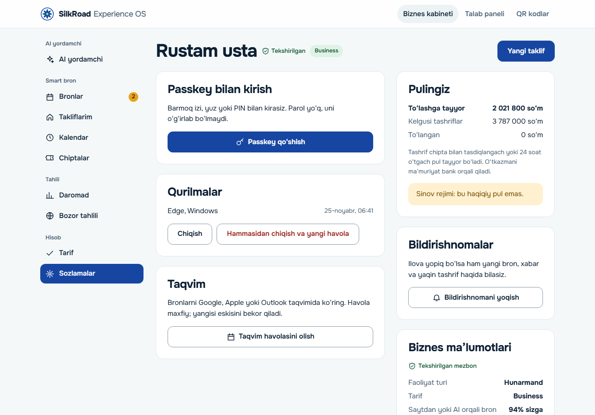
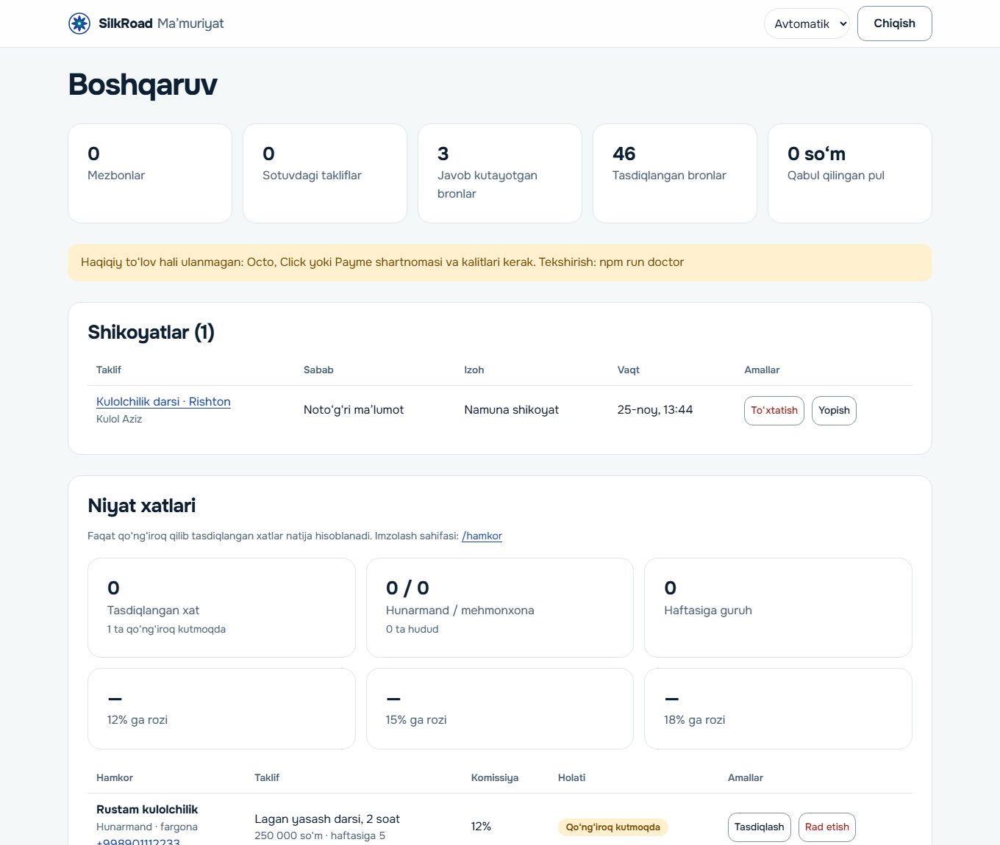
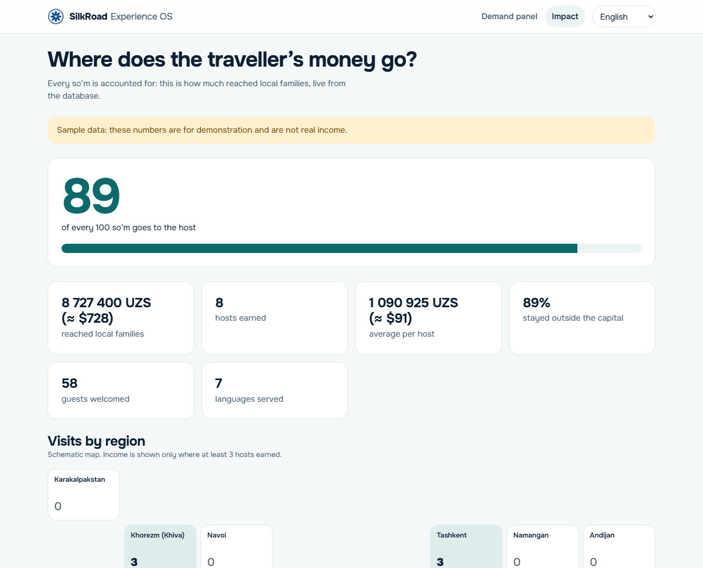

# SilkRoad Experience OS 12.0

**AI-powered Tourism Business Operating System.** Every Local Experience. One Digital Platform. [O‘zbekcha](docs/README.uz.md)

A system that brings local tourism businesses in Uzbekistan online, helps them sell, and helps them earn more.

1. **AI Business Assistant** creates a professional digital service from spoken Uzbek and helps run it.
2. **Smart Experience Booking** manages services, time slots, capacity, trips, payments, refunds and QR check-in.
3. **Tourism Intelligence** shows what travellers look for and how the business performs.


Screenshots show made-up data. See [what still needs the outside world](#what-still-needs-the-outside-world).

## What is new in 12.0

| | |
|---|---|
| **Gift vouchers** | Anyone can buy a visit as a present (`/?gift=1`), from 50,000 to 20 million so‘m, valid 12 months. The buyer gets a printable gift card by e-mail. The code pays all or part of one or more bookings; the balance is taken only when a booking is paid, so it can never be spent twice, and a refunded booking gives it back. |
| **Booking updates in Telegram** | A guest taps one button and gets updates for that booking in Telegram, in their language. Needs `TELEGRAM_BOT_TOKEN` and `TELEGRAM_BOT_NAME`. |
| **Regional demand report** | In `/panel`, one printable page per region for a hokimiyat or tourism department: searches, unmet demand, what and when people looked for, offers, bookings and income (only where three or more makers earned). |
| **Payouts through the bank** | Makers enter their 20-digit account and bank code (MFO). `/admin` lists what each is owed, exports it as a CSV for the bank, and records the whole list in one step once the bank carried it out. |

## New in 11.0

| | |
|---|---|
| **Theme pages** | "Crafts of the Silk Road", "Taste of Uzbekistan", "Village life", "Fergana Valley", "Two hours or less". Each has its own page for search engines and shared links, in ten languages, and fills itself as makers join. |
| **Paid promotion** | A maker can pay 99,000 so‘m for a week at the top of matching searches. Promoted offers always carry a "Promoted" label, and at most two go first. Counted as platform revenue. |
| **Give 10%, get 10%** | A guest who paid gets a code to share. Friends book 10% cheaper; for each friend who pays, the guest receives a 10% code for next time. Never for booking with one's own code. |
| **Groups and private visits** | A school, company or tour group asks for a price. The maker answers with a time and one total in the cabinet; the guest books that quote, and it is confirmed as soon as it is paid. The guest's e-mail stays hidden from the maker. |

## New in 10.0

| | |
|---|---|
| **Found in search and in shared links** | Each offer page carries its title, description, picture, price and rating for search engines and for previews in Telegram, WhatsApp and Instagram, in ten languages. A sitemap lists every real offer; bookings and private pages are kept out. |
| **Promo codes** | For hotels, guides, bloggers and campaigns, with a limit and an end date. The platform pays the discount from its own share, so a maker earns the same. `/admin` shows what each code brought and cost. |
| **Winning back unfinished bookings** | One e-mail when a hold ran out unpaid and the place is still free. The link really works: the guest gets a fresh half hour. |
| **After the visit** | One e-mail asking for a review, with three more experiences nearby. |
| **Instant confirmation** | A maker can confirm every paid booking at once; the guest gets the ticket immediately. |

## New in 9.0

| | |
|---|---|
| **Resellers (OCTO standard)** | Tour operators, hotels, apps and booking sites sell offers through the open [OCTO](https://docs.octo.travel) API at `/octo`, each with its own key and share. Makers choose which offers may be resold. |
| **Paid add-ons** | Transfer, lunch, the finished piece packed for travel, photos: per person or per group. |
| **Booking box for the maker's own website** | One code to paste; payment opens in a new tab. |

Plans for what comes next: [docs/ROADMAP.md](docs/ROADMAP.md).

## New in 8.0

| | |
|---|---|
| **Live everywhere** | Places, offers, bookings, the demand panel and the impact page update on an open screen by themselves. The stream says only that something changed; nothing personal travels in it. |
| **Instant search** | Results follow every keystroke in ten languages, with counts per activity and region, quick days, a price limit and a shareable address. When a day is full, the nearest free days are offered. |
| **Next free time** | Every card shows when you can really go, how many places are left and what it costs then. |
| **Prices that move** | Providers set weekend, last-minute and group prices and see the result before saving. One formula serves the server and the browser, and a higher price never applies without a new yes. |
| **Waiting list** | A guest who found a full time is written to once, first come, first served. The provider sees how many wait and opens places with one tap. |
| **Provider's day** | Coming visits with the time left to each, filters and search in bookings. |
| **Photos on the whole screen** | Swipe, arrow keys or buttons. |



## Since 7.0

| | |
|---|---|
| **Letters of intent** | Makers, hotels and partners read and sign a letter at `/hamkor`, with a price and the commission they would accept. An administrator calls and confirms it. Only confirmed letters are counted. |
| **Live stage** | `/stage` puts the traveller, the provider and the public result on one screen for a pitch. They are really connected. Uzbek or English, works with a presentation clicker, demonstrations only. |
| **Public demonstration** | `render.yaml` puts a clearly marked demo with sample data on a public address. It refuses real payment keys. |



## Since 6.0

| | |
|---|---|
| **Click** | A third payment company next to Octo and Payme, with automatic refunds. |
| **One payment for a trip** | Pay every host at once. If one cannot accept, only that part goes back. |
| **Finding the door** | Exact address, map and phone, shown only to a confirmed guest. |
| **E-mail** | Receipts, confirmations, reminders, "find my booking" and sign-in links, in ten languages. |
| **Own currency** | Approximate prices by the Central Bank's daily rate. Payment is in so‘m. |
| **Impact page** | `/impact` shows publicly how much reached local families. |
| **Investor numbers** | Funnel, take rate, retention and monthly results in `/admin`, from real payments only. |
| **Launch check** | `npm run doctor` tests a real installation from the outside. |
| **Two-step administration** | Codes from an authenticator app. |

## Also in the system

| | |
|---|---|
| **PostgreSQL** | Every rule that protects money or places is enforced by the database as well as the code. |
| **Real payments** | Octo (Visa, Mastercard, Uzcard, Humo) and Payme, with refunds, plans and a payout ledger. |
| **Trip planner** | A route built only from places that are really free, reserved as a whole or not at all. |
| **Passkeys** | Providers sign in with a fingerprint, face or PIN. There are no passwords to steal. |
| **Administration** | Verified hosts, reports, suspension, refunds, payouts and an audit log that cannot be edited. |
| **Trust** | Host profiles with reply times, verified badges, an answer deadline with automatic refund. |

<table>
<tr><td></td><td></td></tr>
<tr><td></td><td></td></tr>
<tr><td></td><td></td></tr>
<tr><td></td><td></td></tr>
<tr><td></td><td></td></tr>
</table>

## Run it

You need [Node.js 24+](https://nodejs.org) and [PostgreSQL](https://www.postgresql.org/download/) installed (tested on 18).

```bash
npm install
npm run db:local   # a private database for this project: own folder, port and random passwords
npm start
```

Open <http://localhost:4321> (travellers), `/mezbon` (providers), `/panel` (demand) or `/qr` (hotel codes). The first start adds clearly marked sample data. For `/admin`, set `ADMIN_KEY` in `.env`.

| Command | Purpose |
|---|---|
| `npm run demo` | A complete pitch demo with a month of sample activity, in its own database, on port 4322. Open `/stage` to present |
| `npm test` | All tests, on a real PostgreSQL |
| `npm run dev` | Start and restart on changes |
| `npm run check` | Syntax check |
| `npm run db:stop`, `npm run db:reset` | Stop or delete the local database |
| `npm run backup -- --verify` | Back up, then prove the backup restores |

Without a Claude key the app runs in **demo mode**: facts are extracted by rules and text comes from templates. All settings are explained in [.env.example](.env.example).

## Put it online

`compose.yaml` runs PostgreSQL, the app and Caddy (automatic HTTPS) on one server:

```bash
cp .env.example .env      # fill in SITE_DOMAIN, passwords, ADMIN_KEY and payment keys
docker compose up -d
npm run doctor            # says what is ready and what is not
```

The server refuses to start in production without HTTPS and an admin key. Step by step, in Uzbek: [docs/LAUNCH.md](docs/LAUNCH.md). Run `npm run backup` daily from a scheduler, and store the copies somewhere else.

### A public demonstration

[Deploy to Render](https://render.com/deploy?repo=https://github.com/GiyosjonJumayev/mezbonAI) reads `render.yaml` from the main branch. It is meant for showing, not for guests: every page says it is a demonstration, search engines are told not to index it, only test payments work, and Render deletes free databases after 30 days. Not yet tried on Render itself.

## Payments

Guests pay on the payment company's own page. Card data never reaches this server.

| | Octo | Click | Payme |
|---|---|---|---|
| Cards | Visa, Mastercard, Uzcard, Humo | Uzcard, Humo | Uzcard, Humo |
| How a payment is trusted | The server asks Octo itself; amount and id must match | Signed Prepare and Complete calls | Payme calls with its own key |
| Address to register | sent with each payment | `https://your-domain/pay/click` | `https://your-domain/pay/payme` |
| Refunds | automatic, whole or part | automatic, whole, within the month | made in Payme's cabinet, recognised automatically |
| Whole trip in one payment | yes | no | no |

Set the keys of at least one company in `.env`. Test payments switch off as soon as one is set.

- Money goes back when the provider declines, when the guest cancels 24 hours or more ahead, when nobody answers within 24 hours, when the place is already gone, or when a booking was paid twice.
- A provider's money becomes available after check-in, or a day after the visit. Payouts are **recorded** by an administrator after a bank transfer. The server itself never sends money.

## Business model

| | Free | Pro | Business |
|---|---|---|---|
| Price per 30 days | 0 | 149 000 UZS | 490 000 UZS |
| Commission on new bookings | 12% | 8% | 6% |
| Listings on sale | 3 | unlimited | unlimited |
| AI assistant messages per day | 15 | 100 | 300 |
| Revenue analytics | 30 days | 1 year, by listing, channel and language, CSV | same as Pro |
| Market intelligence | | | price benchmarks, unmet demand, tips |

Prices and limits are placeholders to test with real providers: change them in `src/domain/plans.mjs`. Plans never renew by themselves. Upgrading credits unused days.

## How it is built

```
src/main.mjs          starts everything; refuses unsafe settings
src/config.mjs        the only place that reads the environment
src/app.mjs           joins domain, notifications and HTTP
src/db/               PostgreSQL access, transactions, numbered migrations
src/domain/           the rules: accounts, catalog, availability, pricing, waitlist, bookings, trips, plans, insights, metrics, partners, stage, assistant, admin, push, mail, rates
src/payments/         bills, refunds and payouts; Octo client; Click SHOP API; Payme Merchant API
src/ai/               Claude, and the rule-based Uzbek engine used without it
src/http/             security checks, routes, live streams, static files
src/adapters/         Telegram bot, MCP server for AI assistants
public/               pages in plain JavaScript modules, no build step
test/                 every test gets its own fresh PostgreSQL database
```

- **Layers point one way:** HTTP, Telegram and MCP call the domain; the domain calls the database. Nothing in the domain knows about HTTP.
- **Transactions:** selling, moving and paying for a place queue on its listing, so two guests cannot buy the last one. Deadlocks are retried. Notifications go out only after the data is saved.
- **Two database accounts:** migrations run as the owner; the server works with an account that can only read and write rows, and can only add to the audit log.

Runtime dependencies: `pg`, `nodemailer`, the Anthropic SDK, the MCP SDK, `@simplewebauthn/server`, `zod`, `qrcode` and `web-push`.

Security measures and how to report a problem: [SECURITY.md](SECURITY.md).

## Connect an AI assistant (MCP)

With the server running, add this to your MCP client. It can search, plan a trip, check places and hold a booking. It can never pay.

```json
{ "mcpServers": { "silkroad": { "command": "node", "args": ["/path/to/mezbonAI/src/adapters/mcp.mjs"] } } }
```

## What has been checked

- 201 automated tests on PostgreSQL 18: rules, payments, simultaneous use, security, HTTP, MCP and Telegram.
- Page views in real Microsoft Edge (light, dark, and a 320-pixel phone): 87 in version 6, and the new or changed pages since (73 views in version 8): no axe-core accessibility problems, no sideways scrolling and no console errors.
- Sign-up, passkey sign-in and sign-out, trip planning and reservation, test payment, receipt, meeting point, refund, administration, signing a letter, the whole live stage, live places and prices, and the waiting list were driven in Edge.
- The Central Bank rate feed was read live.

## What still needs the outside world

- **Payment contracts.** Octo, Click and Payme follow their published documentation and were tested against local stand-ins, not their live services. You need a merchant contract, keys and their own acceptance test.
- **The container setup** (Docker, Caddy) could not be run on the development computer. CI starts the container.
- **The Claude path** is tested against a stand-in server, not yet against the live API. Without a key, the assistant and the trip wish understand a fixed set of phrases.
- **A letter of intent** is not a contract. The signature is a typed name with a saved copy of the text, not a qualified electronic signature.
- **Push, Telegram and e-mail** are tested with stand-ins. They need HTTPS, a bot token and a mail server.
- **Listing artwork** is generated. Real photos must come from providers.
- **Speech recognition** is the browser's own. It needs Chrome and internet, and sends audio to the browser vendor.
- **Translations** have not been reviewed by native speakers.
- **Guide certificates and the verified badge** depend on an administrator really looking at documents. There is no registry check.
- **Overnight stays** are not supported. Guesthouses can sell experiences such as dinners or workshops.
- **GetYourGuide, Viator and Klook** are not connected. There is a neutral export at `/feeds/products.json`.
- **The waiting list**, win-back, after-visit, referral reward and group quote e-mails work only with a mail server.
- **The OCTO API** follows the published core specification and was tested with this project's own tests, not yet with a real reseller. GetYourGuide and Viator need their own certification.
- **Payout list format.** The CSV has account, MFO, recipient and amount; your bank may want its own column order. Banks with an API can later replace the file.
- **Gift vouchers** are a prepayment: check with an accountant how to book and tax them.
- **Reseller money** arrives on a monthly statement. Do not pay makers their part of a reseller sale before the reseller has paid.
- **Text search** looks through the offers the page has loaded (up to 200).
- **One server process.** Live events and rate limits are kept in memory. Running several copies needs a shared store.
- **Law.** Contracts, taxes, fiscal receipts and Uzbek rules on storing citizens' personal data in the country need a lawyer before launch.

## Credits

Interface font: [Onest](https://github.com/simpals/onest), SIL Open Font License ([text](public/fonts/OFL.txt)).
