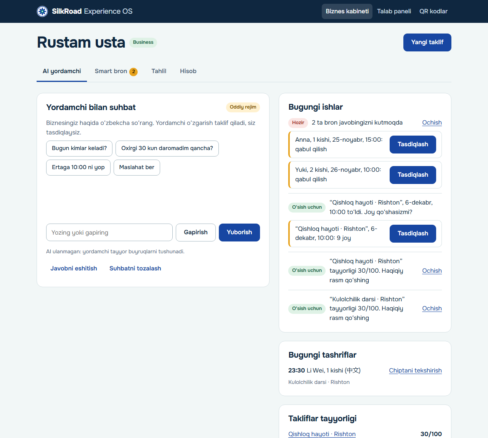
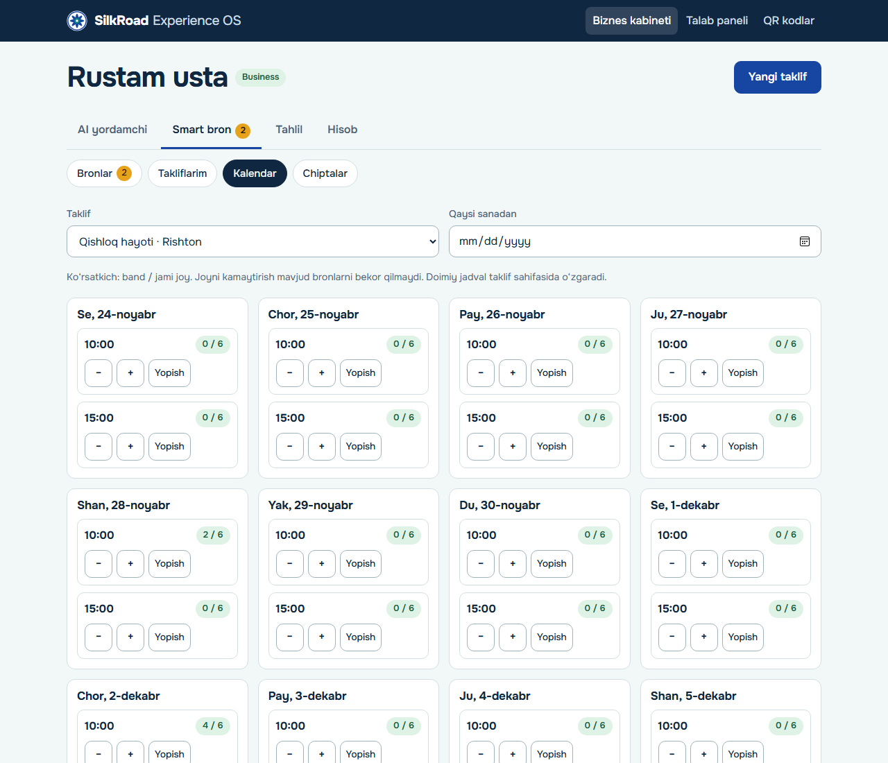

# SilkRoad Experience OS 2.0

**AI-powered Tourism Business Operating System.** Every Local Experience. One Digital Platform. [O‘zbekcha](docs/README.uz.md)

Not just a marketplace: a system that brings local tourism businesses in Uzbekistan online, helps them sell, and helps them earn more.

1. **AI Business Assistant** creates a professional digital service from spoken Uzbek and helps run it.
2. **Smart Experience Booking** manages the service, time slots, capacity, bookings and QR check-in.
3. **Tourism Intelligence** shows what travellers look for and how the business performs.


Screenshots show made-up data. This is a working hackathon prototype: see [what is not real yet](#what-is-not-real-yet).

## What it does

| Pillar | What is in it |
|---|---|
| **AI Business Assistant** | Listings in 10 languages from Uzbek speech. A chat that answers from the provider's own numbers and proposes changes: prices, slots, days off, texts, bookings, replies. A daily list of tasks and visits. A readiness score for each listing with the next step. |
| **Smart Experience Booking** | Search by region, activity, date and group size. Per-slot capacity. Guests move or cancel a visit up to 24 hours before. Translated chat. QR tickets with one-time check-in. Hotel lobby QR codes. An MCP server for AI assistants, which never pays. |
| **Tourism Intelligence** | Revenue, fees, conversion, busy hours, no-shows and CSV for providers. Price benchmarks, unmet demand and travel dates in the Business plan. A public panel of unmet demand by region, activity, date and language, with no personal data. |

<table>
<tr><td></td><td></td></tr>
<tr><td></td><td></td></tr>
<tr><td></td><td></td></tr>
</table>

## Business model

| | Free | Pro | Business |
|---|---|---|---|
| Price per 30 days | 0 | 149 000 UZS | 490 000 UZS |
| Commission on new bookings | 12% | 8% | 6% |
| Listings on sale | 3 | unlimited | unlimited |
| AI assistant messages per day | 15 | 100 | 300 |
| Revenue analytics | 30 days | 1 year, by listing, channel and language, CSV | same as Pro |
| Market intelligence | | | price benchmarks, unmet demand, tips |

Prices and limits are placeholders to test with real providers: change them in `PLANS` in `src/business.mjs`. Plans never renew by themselves. Upgrading credits unused days. A plan change only affects new bookings.

## Rules enforced in code

- A listing cannot go live with a missing price or duration, and guided tours need a certificate number.
- A place cannot be sold twice. Shrinking or closing a slot never cancels existing bookings.
- The assistant cannot change anything by itself. Each proposed action needs the provider's approval and runs through the same checks as the buttons. Guest names, keys and booking links are not sent to the AI provider; guests' messages are, as data only.
- Moving a visit keeps the price, needs the provider's approval again and replaces the ticket.
- A ticket exists only for a confirmed booking, works once, on its own day, and only for its own provider.
- Price benchmarks need at least three other listings, so no single competitor's price is revealed.

## Run it

Requires Node.js 24 or newer.

```bash
npm install
npm start
```

Open <http://localhost:4321> (travellers), `/mezbon` (providers), `/panel` (demand) or `/qr` (hotel codes). The first start adds clearly marked sample data.

| Command | Purpose |
|---|---|
| `npm run dev` | Start and restart on changes |
| `npm test` | Run all tests |
| `npm run check` | Syntax check |
| `npm run reset` | Delete the local database (stop the server first) |
| `npm run telegram` | Run the host bot |

No configuration is needed. Without an API key the app runs in **demo mode**: facts are extracted by rules and text comes from templates. Copy `.env.example` to `.env` to add a Claude key, let phones connect, or switch on Telegram.

## Connect an AI assistant (MCP)

With the server running, add this to your MCP client, such as Claude Desktop:

```json
{ "mcpServers": { "silkroad": { "command": "node", "args": ["/path/to/mezbonAI/src/mcp.mjs"] } } }
```

## How it is built

```
public/            pages in plain JavaScript modules, no build step
src/core.mjs       listings, search, booking, capacity, chat, reviews, access
src/business.mjs   plans, QR tickets, slot control, analytics, market intelligence
src/assistant.mjs  AI Business Assistant: daily brief, chat, approved actions
src/ai.mjs         Claude: structured extraction and translation
src/extract.mjs    rule-based Uzbek extraction, the fallback when AI is unavailable
src/db.mjs         SQLite schema and migrations
src/server.mjs     HTTP API, live events, static files
src/mcp.mjs        MCP server
src/telegram.mjs   Telegram bot
test/              tests for the rules, HTTP API, MCP, Telegram and migrations
```

Four runtime dependencies: the Anthropic SDK, the MCP SDK, `zod` and `qrcode`. SQLite is built into Node.

**Adding a language:** add it to `LANGS` and to every list in `src/i18n.mjs`. A test fails if any string is missing.

## What is not real yet

- **Payments and subscriptions** are test buttons. No money moves. A licensed payment partner is needed. With `NODE_ENV=production` the buttons are off.
- **GetYourGuide, Viator and Klook** are not connected. There is only a neutral export at `/feeds/products.json`.
- **The Claude path** is tested against a stand-in server, not yet against the live API.
- **Without a Claude key** the assistant understands a fixed set of Uzbek requests, not free conversation.
- **Reminders** are not sent. Guests and providers see changes when they open the page; Telegram providers also get messages.
- **Speech recognition** is the browser's own. It needs Chrome and internet, and sends audio to the browser vendor. Few devices have an Uzbek voice, so text is read with a Turkish one.
- **Telegram** voice notes are not transcribed, and the bot has not been run against the live Telegram service.
- **Translations** have not been reviewed by native speakers.
- **Overnight stays** are not supported. Guesthouses can sell experiences such as dinners or workshops.
- **The in-app camera scanner** has not been tried on a real phone and needs HTTPS there. A phone's own camera app also works, and codes can be typed.
- **Sign-in** for providers is a secret link, one per business. There are no staff accounts, SMS check or recovery.
- **Guide certificates** are asked for but not checked against a registry.
- **The panel** is public. It shows totals only.
- **HTTPS** is not included. Put a reverse proxy in front before going online.

## Credits

Interface font: [Onest](https://github.com/simpals/onest), SIL Open Font License ([text](public/fonts/OFL.txt)).
