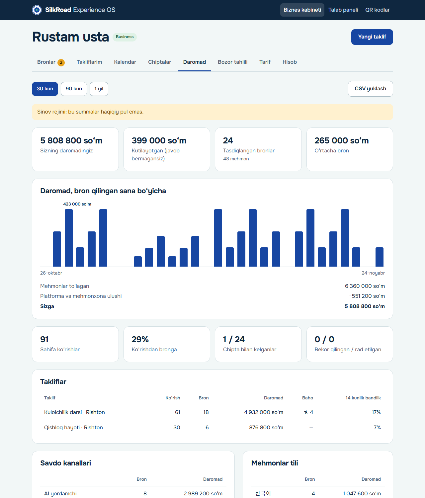
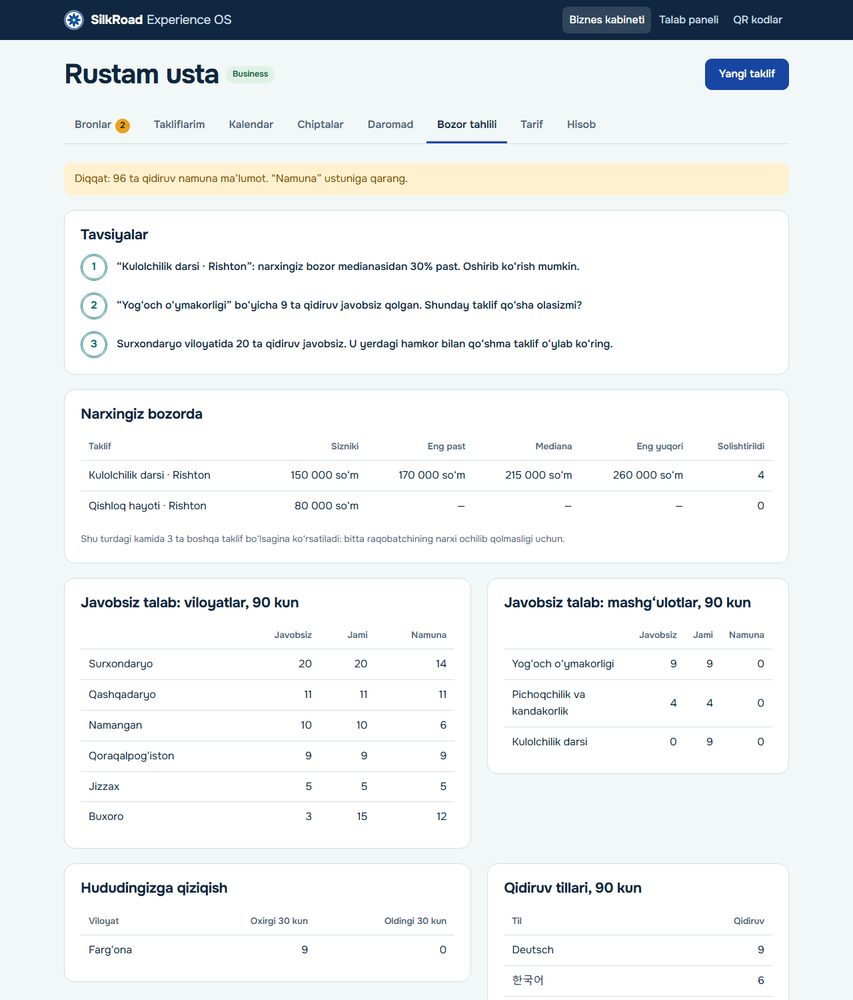
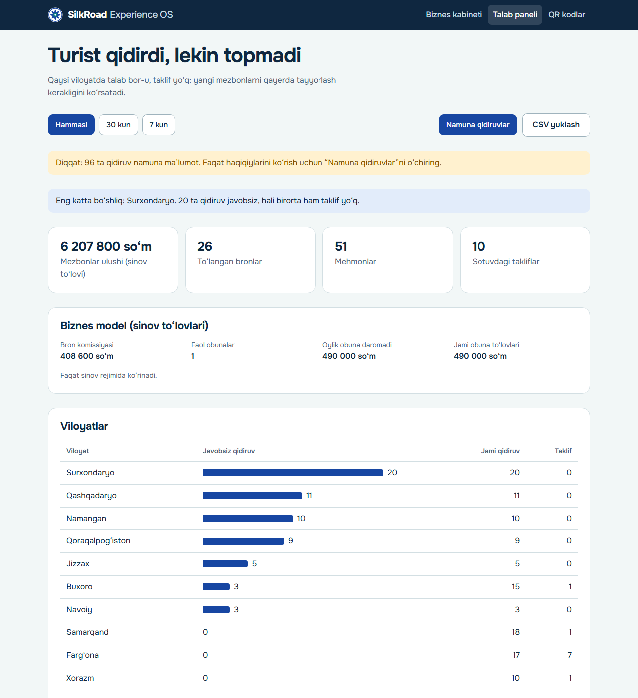

# SilkRoad Experience OS

**Every Local Experience. One Digital Platform.** [O‘zbekcha](docs/README.uz.md)

An AI-powered operating system for local tourism businesses in Uzbekistan: artisans, family guesthouses and experience providers. They describe what they do in Uzbek, by voice or text, and sell it to travellers in ten languages.


Screenshots show made-up data. This is a working hackathon prototype: see [what is not real yet](#what-is-not-real-yet).

## What it does

| For | What they get |
|---|---|
| **Providers** | Multilingual listings from Uzbek speech. Bookings and chat in Uzbek, live and read aloud. A calendar to open, close or resize any single time slot. QR ticket check-in. Revenue analytics. |
| **Travellers** | Search by region, activity, date and group size in 10 languages. Book, chat, get a QR ticket, add to calendar, cancel up to 24 hours before, and review after the visit. |
| **Hotels** | A QR code for the lobby and 8% of each booking made through it. |
| **Tourism offices** | A panel of unmet demand: where travellers searched and found nothing. CSV export, no personal data. |
| **AI assistants** | An MCP server to search, check availability and hold a place. Payment is always left to the traveller. |

<table>
<tr><td></td><td></td></tr>
<tr><td></td><td></td></tr>
<tr><td></td><td></td></tr>
</table>

## Business model

| | Free | Pro | Business |
|---|---|---|---|
| Price per 30 days | 0 | 149 000 UZS | 490 000 UZS |
| Commission on new bookings | 12% | 8% | 6% |
| Listings on sale | 3 | unlimited | unlimited |
| Revenue analytics | 30 days | 1 year, by listing, channel and language, CSV | same as Pro |
| Market intelligence | | | price benchmarks, unmet demand, tips |

Prices and limits are placeholders to test with real providers: change them in `PLANS` in `src/business.mjs`. Plans never renew by themselves. Upgrading credits unused days. A plan change only affects new bookings.

## Rules enforced in code

- A listing cannot go live with a missing price or duration, and guided tours need a certificate number.
- A place cannot be sold twice. Shrinking or closing a slot never cancels existing bookings.
- A ticket exists only for a confirmed booking, works once, on its own day, and only for its own provider.
- Price benchmarks need at least three other listings, so no single competitor's price is revealed.

## Run it

Requires Node.js 24 or newer.

```bash
npm install
npm start
```

Open <http://localhost:4321> (travellers), `/mezbon` (providers), `/panel` (demand) or `/qr` (hotel codes). The first start adds clearly marked sample data.

| Command | Purpose |
|---|---|
| `npm run dev` | Start and restart on changes |
| `npm test` | Run all tests |
| `npm run check` | Syntax check |
| `npm run reset` | Delete the local database (stop the server first) |
| `npm run telegram` | Run the host bot |

No configuration is needed. Without an API key the app runs in **demo mode**: facts are extracted by rules and text comes from templates. Copy `.env.example` to `.env` to add a Claude key, let phones connect, or switch on Telegram.

## Connect an AI assistant (MCP)

With the server running, add this to your MCP client, such as Claude Desktop:

```json
{ "mcpServers": { "silkroad": { "command": "node", "args": ["/path/to/mezbonAI/src/mcp.mjs"] } } }
```

## How it is built

```
public/            pages in plain JavaScript modules, no build step
src/core.mjs       listings, search, booking, capacity, chat, reviews, access
src/business.mjs   plans, QR tickets, slot control, analytics, market intelligence
src/ai.mjs         Claude: structured extraction and translation
src/extract.mjs    rule-based Uzbek extraction, the fallback when AI is unavailable
src/db.mjs         SQLite schema and migrations
src/server.mjs     HTTP API, live events, static files
src/mcp.mjs        MCP server
src/telegram.mjs   Telegram bot
test/              tests for the rules, HTTP API, MCP, Telegram and migrations
```

Four runtime dependencies: the Anthropic SDK, the MCP SDK, `zod` and `qrcode`. SQLite is built into Node.

**Adding a language:** add it to `LANGS` and to every list in `src/i18n.mjs`. A test fails if any string is missing.

## What is not real yet

- **Payments and subscriptions** are test buttons. No money moves. A licensed payment partner is needed. With `NODE_ENV=production` the buttons are off.
- **GetYourGuide, Viator and Klook** are not connected. There is only a neutral export at `/feeds/products.json`.
- **The Claude path** is tested against a stand-in server, not yet against the live API.
- **Speech recognition** is the browser's own. It needs Chrome and internet, and sends audio to the browser vendor. Few devices have an Uzbek voice, so text is read with a Turkish one.
- **Telegram** voice notes are not transcribed, and the bot has not been run against the live Telegram service.
- **Translations** have not been reviewed by native speakers.
- **Overnight stays** are not supported. Guesthouses can sell experiences such as dinners or workshops.
- **The in-app camera scanner** has not been tried on a real phone and needs HTTPS there. A phone's own camera app also works, and codes can be typed.
- **Sign-in** for providers is a secret link, one per business. There are no staff accounts, SMS check or recovery.
- **Guide certificates** are asked for but not checked against a registry.
- **The panel** is public. It shows totals only.
- **HTTPS** is not included. Put a reverse proxy in front before going online.

## Credits

Interface font: [Onest](https://github.com/simpals/onest), SIL Open Font License ([text](public/fonts/OFL.txt)).
