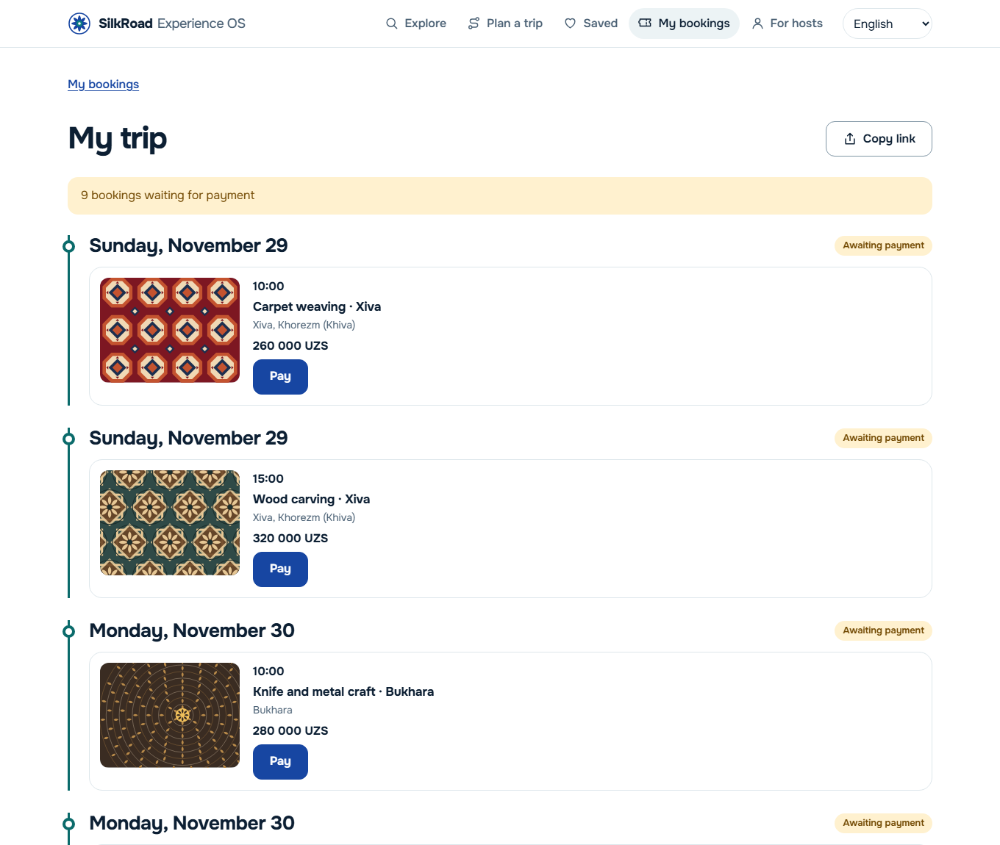
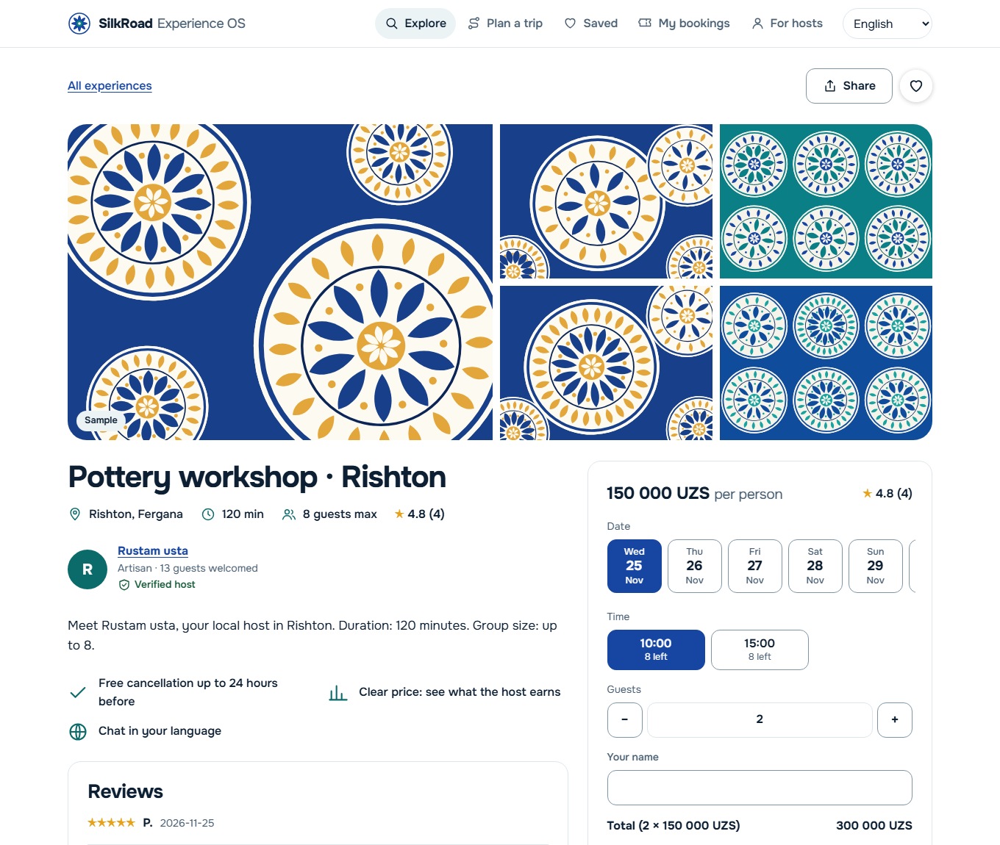
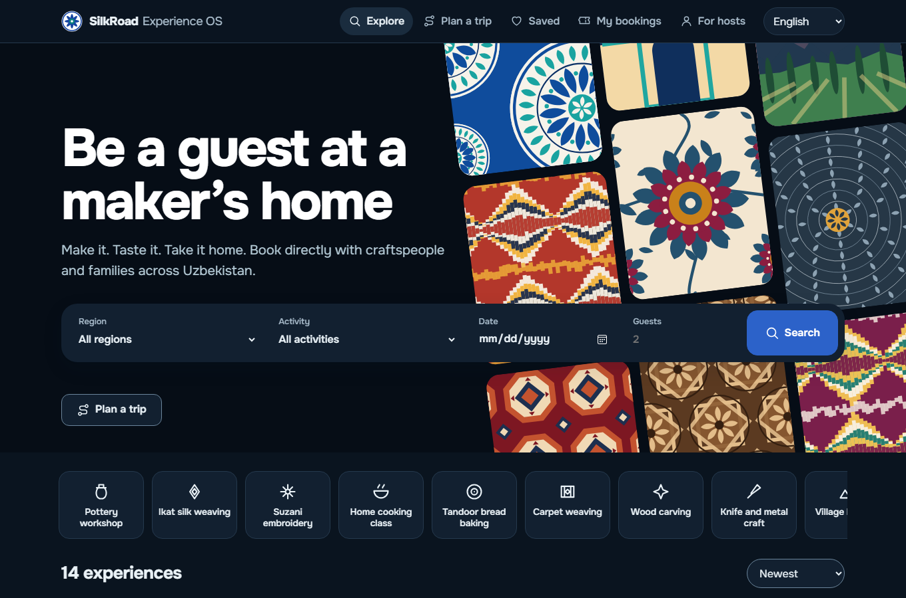

# SilkRoad Experience OS 5.0

**AI-powered Tourism Business Operating System.** Every Local Experience. One Digital Platform. [O‘zbekcha](docs/README.uz.md)

A system that brings local tourism businesses in Uzbekistan online, helps them sell, and helps them earn more.

1. **AI Business Assistant** creates a professional digital service from spoken Uzbek and helps run it.
2. **Smart Experience Booking** manages services, time slots, capacity, trips, payments, refunds and QR check-in.
3. **Tourism Intelligence** shows what travellers look for and how the business performs.


Screenshots show made-up data. See [what still needs the outside world](#what-still-needs-the-outside-world).

## What is new in 5.0

| | |
|---|---|
| **PostgreSQL** | Every rule that protects money or places is enforced by the database as well as the code. |
| **Real payments** | Octo (Visa, Mastercard, Uzcard, Humo) and Payme, with refunds, plans and a payout ledger. |
| **Trip planner** | A route built only from places that are really free, reserved as a whole or not at all. |
| **Passkeys** | Providers sign in with a fingerprint, face or PIN. There are no passwords to steal. |
| **Administration** | Verified hosts, reports, suspension, refunds, payouts and an audit log that cannot be edited. |
| **Trust** | Host profiles with reply times, verified badges, an answer deadline with automatic refund. |

<table>
<tr><td></td><td></td></tr>
<tr><td></td><td></td></tr>
<tr><td></td><td></td></tr>
<tr><td></td><td></td></tr>
<tr><td></td><td></td></tr>
</table>

## Run it

You need [Node.js 24+](https://nodejs.org) and [PostgreSQL](https://www.postgresql.org/download/) installed (tested on 18).

```bash
npm install
npm run db:local   # a private database for this project: own folder, port and random passwords
npm start
```

Open <http://localhost:4321> (travellers), `/mezbon` (providers), `/panel` (demand) or `/qr` (hotel codes). The first start adds clearly marked sample data. For `/admin`, set `ADMIN_KEY` in `.env`.

| Command | Purpose |
|---|---|
| `npm run demo` | A complete pitch demo with a month of sample activity, in its own database, on port 4322 |
| `npm test` | All tests, on a real PostgreSQL |
| `npm run dev` | Start and restart on changes |
| `npm run check` | Syntax check |
| `npm run db:stop`, `npm run db:reset` | Stop or delete the local database |
| `npm run backup -- --verify` | Back up, then prove the backup restores |

Without a Claude key the app runs in **demo mode**: facts are extracted by rules and text comes from templates. All settings are explained in [.env.example](.env.example).

## Put it online

`compose.yaml` runs PostgreSQL, the app and Caddy (automatic HTTPS) on one server:

```bash
cp .env.example .env      # fill in SITE_DOMAIN, passwords, ADMIN_KEY and payment keys
docker compose up -d
```

The server refuses to start in production without HTTPS and an admin key. Run `npm run backup` daily from a scheduler, and store the copies somewhere else.

## Payments

Guests pay on the payment company's own page. Card data never reaches this server.

| | Octo | Payme |
|---|---|---|
| Cards | Visa, Mastercard, Uzcard, Humo | Uzcard, Humo |
| How a payment is trusted | Any notification makes the server ask Octo itself; amount and payment id must match | Payme calls the server with its own key (Merchant API) |
| Notification address to register | sent with each payment | `https://your-domain/pay/payme` |
| Refunds | automatic, safe to repeat | made in Payme's cabinet, recognised automatically |

Set `OCTO_SHOP_ID` and `OCTO_SECRET`, or `PAYME_MERCHANT_ID` and `PAYME_KEY`. Test payments switch off as soon as one is set.

- Money goes back when the provider declines, when the guest cancels 24 hours or more ahead, when nobody answers within 24 hours, when the place is already gone, or when a booking was paid twice.
- A provider's money becomes available after check-in, or a day after the visit. Payouts are **recorded** by an administrator after a bank transfer. The server itself never sends money.

## Business model

| | Free | Pro | Business |
|---|---|---|---|
| Price per 30 days | 0 | 149 000 UZS | 490 000 UZS |
| Commission on new bookings | 12% | 8% | 6% |
| Listings on sale | 3 | unlimited | unlimited |
| AI assistant messages per day | 15 | 100 | 300 |
| Revenue analytics | 30 days | 1 year, by listing, channel and language, CSV | same as Pro |
| Market intelligence | | | price benchmarks, unmet demand, tips |

Prices and limits are placeholders to test with real providers: change them in `src/domain/plans.mjs`. Plans never renew by themselves. Upgrading credits unused days.

## How it is built

```
src/main.mjs          starts everything; refuses unsafe settings
src/config.mjs        the only place that reads the environment
src/app.mjs           joins domain, notifications and HTTP
src/db/               PostgreSQL access, transactions, numbered migrations
src/domain/           the rules: accounts, catalog, availability, bookings, trips, plans, insights, assistant, admin, push
src/payments/         bills, refunds and payouts; Octo client; Payme Merchant API
src/ai/               Claude, and the rule-based Uzbek engine used without it
src/http/             security checks, routes, static files
src/adapters/         Telegram bot, MCP server for AI assistants
public/               pages in plain JavaScript modules, no build step
test/                 every test gets its own fresh PostgreSQL database
```

- **Layers point one way:** HTTP, Telegram and MCP call the domain; the domain calls the database. Nothing in the domain knows about HTTP.
- **Transactions:** selling, moving and paying for a place queue on its listing, so two guests cannot buy the last one. Deadlocks are retried. Notifications go out only after the data is saved.
- **Two database accounts:** migrations run as the owner; the server works with an account that can only read and write rows, and can only add to the audit log.

Runtime dependencies: `pg`, the Anthropic SDK, the MCP SDK, `@simplewebauthn/server`, `zod`, `qrcode` and `web-push`.

Security measures and how to report a problem: [SECURITY.md](SECURITY.md).

## Connect an AI assistant (MCP)

With the server running, add this to your MCP client. It can search, plan a trip, check places and hold a booking. It can never pay.

```json
{ "mcpServers": { "silkroad": { "command": "node", "args": ["/path/to/mezbonAI/src/adapters/mcp.mjs"] } } }
```

## What has been checked

- 131 automated tests on PostgreSQL 18: rules, payments, simultaneous use, security, HTTP, MCP and Telegram.
- 78 page views in real Microsoft Edge (light, dark, and a 320-pixel phone): no axe-core accessibility problems, no sideways scrolling and no console errors.
- Sign-up, passkey sign-in and sign-out, trip planning and reservation, test payment, refund and administration were driven in Edge.

## What still needs the outside world

- **Payment contracts.** Octo and Payme follow their published documentation and were tested against local stand-ins, not their live services. You need a merchant contract, keys and their own acceptance test. Click is not connected.
- **The container setup** (Docker, Caddy) could not be run on the development computer. CI starts the container.
- **The Claude path** is tested against a stand-in server, not yet against the live API. Without a key, the assistant and the trip wish understand a fixed set of phrases.
- **Push, Telegram** are tested with stand-ins. They need HTTPS and a bot token.
- **Listing artwork** is generated. Real photos must come from providers.
- **Speech recognition** is the browser's own. It needs Chrome and internet, and sends audio to the browser vendor.
- **Translations** have not been reviewed by native speakers.
- **Guide certificates and the verified badge** depend on an administrator really looking at documents. There is no registry check.
- **A trip is paid booking by booking**, because each host is paid and refunded separately.
- **Overnight stays** are not supported. Guesthouses can sell experiences such as dinners or workshops.
- **GetYourGuide, Viator and Klook** are not connected. There is a neutral export at `/feeds/products.json`.
- **One server process.** Live events and rate limits are kept in memory. Running several copies needs a shared store.
- **Law.** Contracts, taxes, fiscal receipts and Uzbek rules on storing citizens' personal data in the country need a lawyer before launch.

## Credits

Interface font: [Onest](https://github.com/simpals/onest), SIL Open Font License ([text](public/fonts/OFL.txt)).
