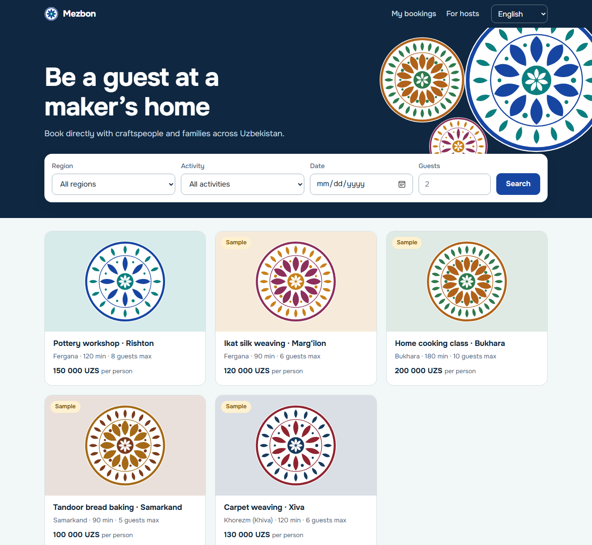
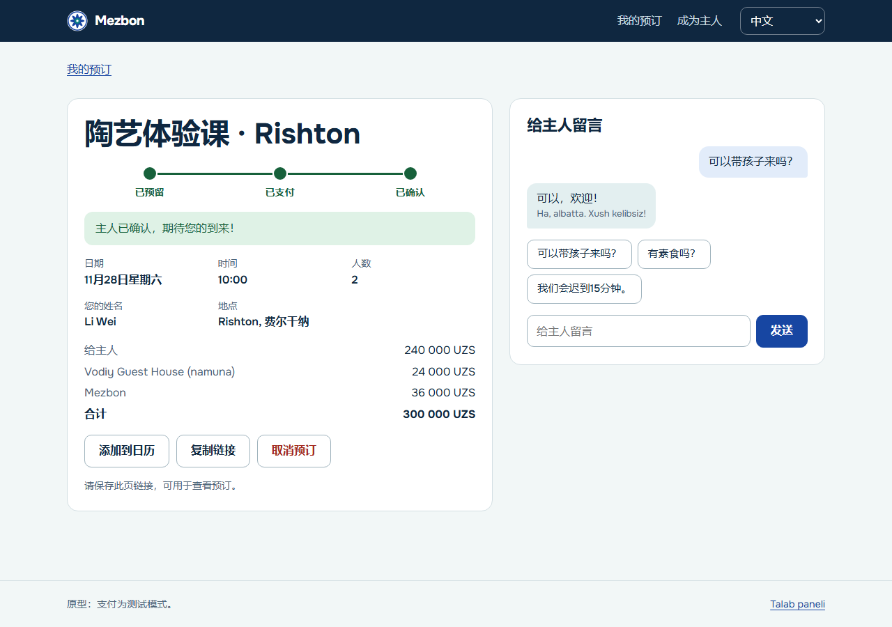
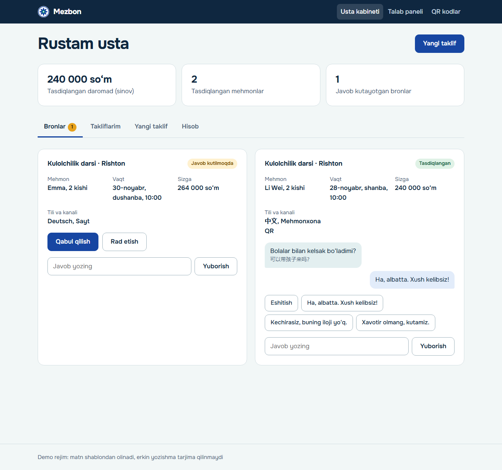

# Mezbon AI

[O‘zbekcha](docs/README.uz.md)

A potter in Rishton describes their craft in Uzbek. Mezbon turns it into an experience that travellers can book in ten languages.



*Mezbon* means "host" in Uzbek. This is a working hackathon prototype: see [what is not real yet](#what-is-not-real-yet).

## What it does

| For | What they get |
|---|---|
| **Hosts** | Speak or type in Uzbek. Price, duration, place and group size are extracted, and text is prepared in 10 languages. Bookings and questions arrive in Uzbek, live, and are read aloud. |
| **Travellers** | Search by region, activity, date and group size. Book, chat, add to calendar, cancel up to 24 hours before, and review after the visit. Arabic is right to left. |
| **Hotels** | A QR code for the lobby and 8% of each booking made through it. |
| **Tourism offices** | A panel of unmet demand: where travellers searched and found nothing. CSV export, no personal data. |
| **AI assistants** | An MCP server to search, check availability and hold a place. Payment is always left to the traveller. |

Some rules are enforced in code: a listing cannot go live with a missing price or duration, guided tours need a certificate number, and a place cannot be sold twice.

<table>
<tr><td></td><td></td></tr>
<tr><td></td><td></td></tr>
</table>

## Run it

Requires Node.js 24 or newer.

```bash
npm install
npm start
```

Open <http://localhost:4321> (travellers), `/mezbon` (hosts), `/panel` (demand) or `/qr` (hotel codes). The first start adds clearly marked sample data.

| Command | Purpose |
|---|---|
| `npm run dev` | Start and restart on changes |
| `npm test` | Run all tests |
| `npm run check` | Syntax check |
| `npm run reset` | Delete the local database (stop the server first) |
| `npm run telegram` | Run the host bot |

No configuration is needed. Without an API key the app runs in **demo mode**: facts are extracted by rules and text comes from templates. Copy `.env.example` to `.env` to add a Claude key, let phones connect, or switch on Telegram.

## Connect an AI assistant (MCP)

With the server running, add this to your MCP client, such as Claude Desktop:

```json
{ "mcpServers": { "mezbon": { "command": "node", "args": ["/path/to/mezbon-ai/src/mcp.mjs"] } } }
```

## How it is built

```
public/            pages in plain JavaScript modules, no build step
src/core.mjs       all business rules: booking, capacity, revenue split, access
src/ai.mjs         Claude: structured extraction and translation
src/extract.mjs    rule-based Uzbek extraction, the fallback when AI is unavailable
src/db.mjs         SQLite schema and migrations
src/server.mjs     HTTP API, live events, static files
src/mcp.mjs        MCP server
src/telegram.mjs   Telegram bot
test/              tests for the rules, HTTP API, MCP, Telegram and migrations
```

Four runtime dependencies: the Anthropic SDK, the MCP SDK, `zod` and `qrcode`. SQLite is built into Node.

**Adding a language:** add it to `LANGS` and to every list in `src/i18n.mjs`. A test fails if any string is missing.

## What is not real yet

- **Payments** are a test button. No money moves. A licensed payment partner is needed. With `NODE_ENV=production` the button is off.
- **GetYourGuide, Viator and Klook** are not connected. There is only a neutral export at `/feeds/products.json`.
- **The Claude path** is tested against a stand-in server, not yet against the live API.
- **Speech recognition** is the browser's own. It needs Chrome and internet, and sends audio to the browser vendor. Few devices have an Uzbek voice, so text is read with a Turkish one.
- **Telegram** voice notes are not transcribed, and the bot has not been run against the live Telegram service.
- **Translations** have not been reviewed by native speakers.
- **Sign-in** for hosts is a secret link. There is no SMS check or recovery.
- **Guide certificates** are asked for but not checked against a registry.
- **The panel** is public. It shows totals only.
- **HTTPS** is not included. Put a reverse proxy in front before going online.

## Credits

Interface font: [Onest](https://github.com/simpals/onest), SIL Open Font License ([text](public/fonts/OFL.txt)).
