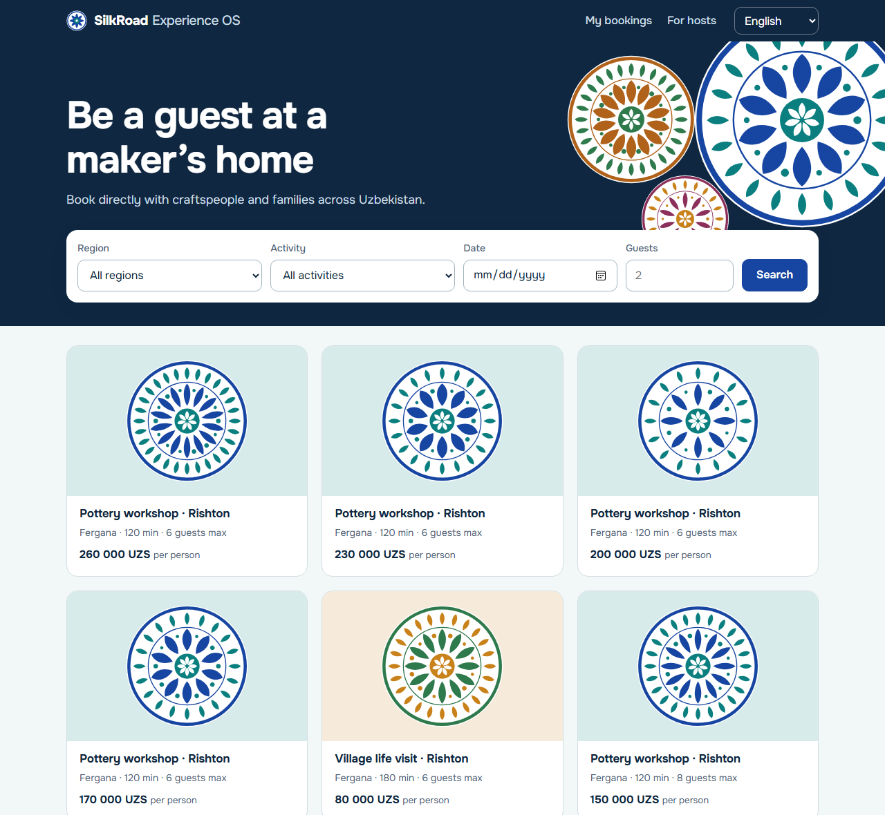

# SilkRoad Experience OS 2.0

**AI-powered Tourism Business Operating System**

[English](../README.md)

Oddiy marketplace emas. Bu mahalliy turizm bizneslarini raqamlashtiradigan, ularning xizmatlarini sotishga va daromadini oshirishga yordam beradigan tizim.

## Uchta asosiy ustunlik

1. **AI Business Assistant**: kichik biznesga professional raqamli xizmat yaratish va boshqarish imkonini beradi.
   - Ovoz yoki matndan 10 tilli taklif.
   - Suhbat: daromad, jadval, narx, talab haqida o‘z raqamlaringiz bilan javob. O‘zgarishni taklif qiladi, siz tasdiqlaysiz.
   - Bugungi ishlar va tashriflar, har bir taklifning tayyorlik bali.
2. **Smart Experience Booking**: xizmat, vaqt, sig‘im, bron va QR check-in.
   - Har bir vaqtni alohida yopish yoki kengaytirish. Mavjud bronlar saqlanadi.
   - Mehmon 24 soat oldin vaqtni ko‘chiradi yoki bekor qiladi.
   - Bir martalik QR chipta, tarjimali yozishma.
3. **Tourism Intelligence**: talab va biznes natijalari.
   - Daromad, konversiya, eng band vaqtlar, kelmaganlar, CSV.
   - Narx taqqosi, javobsiz talab, turistlar qidirgan sanalar va tillar.

**Tariflar**: Bepul (12% komissiya, 3 taklif, kuniga 15 AI xabar), Pro (149 000 so‘m, 8%, 100), Business (490 000 so‘m, 6%, 300). Narxlar taxminiy: `src/business.mjs` dagi `PLANS` da o‘zgaradi.



## Ishga tushirish

Node.js 24 yoki yangiroq kerak.

```powershell
npm install
```

```powershell
npm start
```

| Sahifa | Kim uchun |
|---|---|
| http://localhost:4321 | Turist |
| http://localhost:4321/mezbon | Mahalliy biznes |
| http://localhost:4321/panel | Turizm qo‘mitasi, hokimlik |
| http://localhost:4321/qr | Mehmonxona |

Testlar: `npm test`. Bazani tozalash: serverni to‘xtating, keyin `npm run reset`.

## Sozlash

`.env.example` nusxasini `.env` deb nomlang. `.env` GitHub’ga yuklanmaydi.

- **`ANTHROPIC_API_KEY`**: haqiqiy AI matn va tarjima. Bo‘lmasa **demo rejim**: faktlar qoidalar bilan ajratiladi, matn shablondan olinadi.
- **`MEZBON_OFFLINE=1`**: zalda internet bo‘lmasa, demo rejimni majburlaydi.
- **`HOST=0.0.0.0`**: telefonlar bir xil Wi-Fi orqali kiradi. HTTPS yo‘q, shuning uchun faqat demo vaqtida yoqing.
- **`TELEGRAM_BOT_TOKEN`**: bot alohida oynada `npm run telegram` bilan ishlaydi.

## 3 daqiqalik demo

1. `/mezbon` ni Chrome’da oching, ism yozing, mikrofonni bosib gapiring. Mikrofon ishlamasa: **Namuna matn**.
2. **Taklifni tayyorlash**, tillarni almashtirib ko‘rsating, **E’lon qilish**.
3. Telefondan mehmonxona QR kodini skanerlang, xitoychani tanlab bron qiling, sinov to‘lovini bosing.
4. Usta ekranida bron chiqadi va ovoz eshitiladi. Usta qabul qiladi, mehmonda QR chipta paydo bo‘ladi. **Chiptalar** bo‘limida kodni tekshiring (faqat tashrif kuni qabul qilinadi).
5. **AI yordamchi**da “narxni 180 ming qil” deng va tasdiqlang. **Tarif** bo‘limida sinov obunasini yoqing, **Daromad** va **Bozor tahlili**ni ko‘rsating.
6. `/?region=surxondaryo` ni oching (bo‘sh), keyin `/panel`: talab bor, taklif yo‘q.
7. AI yordamchiga: “Farg‘onada kulolchilik darsini top va joy ushlab tur”.

Demo oldidan Claude kaliti bilan vaqtni o‘lchang. “60 soniya”ni faqat o‘lchagandan keyin ayting.

## Prototipda nima haqiqiy emas

- **To‘lov va obuna**: sinov tugmasi, pul yechilmaydi. Litsenziyali to‘lov hamkori kerak.
- **GetYourGuide, Viator, Klook**: ulanmagan. Faqat `/feeds/products.json` eksporti bor.
- **Namuna ma’lumot**: 4 ta mezbon, 3 ta mehmonxona, 96 ta qidiruv o‘ylab topilgan va belgilangan. `SEED=0` bilan o‘chiriladi.
- **Claude kalitisiz** yordamchi faqat tayyor o‘zbekcha buyruqlarni tushunadi, erkin suhbat emas.
- **Eslatmalar** yuborilmaydi: o‘zgarish sahifada ko‘rinadi, Telegram ulangan mezbonga xabar boradi.
- **Nutqni tanish**: brauzerniki (Chrome, internet kerak). Ovoz brauzer ishlab chiqaruvchisiga yuboriladi.
- **Ovozli o‘qish**: ko‘p qurilmalarda o‘zbek ovozi yo‘q, turkcha ovoz ishlatiladi.
- **Telegram ovozli xabarlari**: matnga aylantirilmaydi.
- **Tarjimalar**: til egalari tekshirmagan.
- **Tunash**: mehmon uyida tunash broni yo‘q, faqat tajribalar (kechki ovqat, master-klass) sotiladi.
- **Kamera skaneri**: haqiqiy telefonda sinalmagan, HTTPS kerak. Telefonning o‘z kamerasi yoki kodni qo‘lda kiritish ham ishlaydi.
- **Kirish**: usta kabineti maxfiy havola bilan ochiladi. SMS tasdiq yo‘q.
- **Gid sertifikati**: raqami so‘raladi, reyestrdan tekshirilmaydi.
